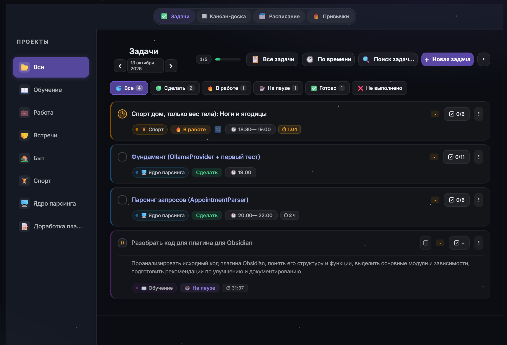

# WorkLife Calendar for Obsidian

> **Забудьте о хаосе.** Умный календарь, трекер задач, учёт времени, контроль привычек и финансов — в одном красивом и связанном пространстве.

<div align="center">

[](https://opensource.org/licenses/MIT)
[](https://obsidian.md)
[](https://svelte.dev/)
[](https://www.typescriptlang.org/)

</div>

---

[**English README**](README.md)



## 💡 Почему этот плагин существует

У многих рабочих процессов одна и та же проблема: задачи живут в одном месте, календарь — в другом, учёт времени — в третьем, а финансы и отчёты собираются вручную в таблицах. В итоге одни и те же данные приходится вводить несколько раз.

**Этот плагин решает именно эту проблему.** Он не просто добавляет ещё один календарь или трекер. Он связывает планирование, выполнение и анализ в одной системе:

- Одна задача влияет на календарь.
- Календарь влияет на учёт времени.
- Время влияет на расчёт дохода.
- Доход формирует автоматическую аналитику.

---

## 🚀 Кому это подойдёт

- **Фрилансерам и разработчикам**, которые хотят автоматически считать стоимость своей работы по часам.
- **Студентам и исследователям**, которым нужно держать в голове дедлайны, проекты и ежедневные привычки.
- **Всем, кто устал** от десятка разрозненных приложений и хочет навести порядок в одном окне Obsidian.

---

## ✨ Что внутри

| Блок | Что вы получаете |
| :--- | :--- |
| **📅 Расписание** | Календарь день / неделя / месяц, Drag & Drop, погода в сетке |
| **✅ Задачи** | Быстрый добавление на естественном языке, канбан, повторы, живой таймер |
| **⏱ Время и доход** | Таймер работы → часы × ставка → автоматический заработок |
| **⚖️ Привычки и здоровье** | Трекер привычек со стриками, график веса |
| **💰 Финансы** | План бюджета, копилка, доходы, расходы, сводки MD / Excel |
| **📊 Аналитика** | Графики по проектам, доходам и привычкам |
| **🤖 Локальный ИИ (Ollama)** | Извлечение задач, саммари, разбор расходов, планы тренировок |
| **🔔 Уведомления** | Напоминания на ПК + push на телефон через ntfy.sh |


>[!NOTE] 🎁 Подарок!
> Зайдите в паполчу `theme`! Плагин с этой темой быдет смотреться намного симпатичнее.

---

## 📦 Установка

### Сторонние плагины (рекомендуется)

1. Откройте **Настройки → Сторонние плагины** в Obsidian.
2. Нажмите **Обзор** и найдите **WorkLife Calendar**.
3. Нажмите **Установить**, затем **Включить**.

### Через BRAT

1. Установите плагин [BRAT](https://github.com/TfTHacker/obsidian42-brat).
2. Откройте настройки BRAT → **Add Beta Plugin**.
3. Вставьте ссылку: `https://github.com/AtinsS/WorkLife-Calendar-for-Obsidian`
4. Нажмите **Add Plugin**.

### Вручную

1. Скачайте архив релиза или клонируйте репозиторий.
2. Скопируйте `main.js`, `manifest.json` и `styles.css`.
3. Поместите их в папку `.obsidian/plugins/worklife-calendar/` (создайте её, если нет).
4. Включите плагин в *Настройки → Сторонние плагины*.

> [!WARNING] Внимание
> Требуется Obsidian **1.13.0+**. Работает на десктопе и мобильных устройствах (ИИ — только на десктопе).


---

## 🧭 Быстрый старт

1. **Задачи** — откройте *Задачи* или нажмите **«Быстро добавить задачу»** и напишите как есть: *«сдать отчёт в пятницу @Работа !срочно»*.
2. **Финансы** — раздел *Финансы*: вкладки **Бюджет / Копилка / Доход / Расходы**. Добавьте первую трату на вкладке «Расходы».
3. **Сводка** — в конце месяца выберите **Markdown** или **Excel** и нажмите **«Сводка»** — получите готовый отчёт.

> [!TIP]
> Настройте **Финансы → Символ валюты** и **Папку для сводок** — это займёт минуту и сразу наведёт порядок в отчётах.

---

## ☕ Поддержка

Если плагин экономит ваше время и помогает в работе, вы можете поддержать разработку:

- ⭐ Поставьте звезду репозиторию.
- [☕ Угостить автора кофе с булочкой](https://boosty.to/atins/donate).

---

<details>
<summary><h3>✨ Подробные возможности (раскрыть)</h3></summary>

## 📅 Умное планирование

- Понимает человеческий язык. Просто напишите: *«! завтра 14:00 сдать проект @Работа»* — и плагин сам расставит дату, время, проект и приоритет.
- ИИ помогает создать несколько задач по одному промпту.
- Визуальный календарь (день / неделя / месяц) с Drag & Drop. Перетащите задачу мышкой, чтобы изменить время.
- Погода прямо в сетке календаря помогает планировать дни более удобно.

## ✅ Фокус и управление задачами

- Канбан-доска и списки: 5 статусов (Сделать → В работе → На паузе → Готово → Не выполнено).
- Живой таймер: запускайте учёт времени прямо из карточки задачи. При перезапуске Obsidian таймер не сбросится. (Таймер запускается, когда задача переходит в статус **«В работе»**, отключить можно в настройках.)
- Повторяющиеся задачи: настройте один раз — ежедневно, еженедельно или ежемесячно.
- Перенос просроченных задач на следующий день (можно отключить).
- Рабочие задачи с почасовой или дневной ставкой — заработок считается автоматически.

## ⚖️ Баланс: привычки и здоровье

- Трекер привычек с графиками прогресса и «стриками» (сериями выполнения).
- Контроль веса: ежедневный ввод и наглядный график движения к цели.

## 💰 Финансы

Единый блок **Финансы** с четырьмя вкладками — план и факт разведены:

| Вкладка | Что внутри |
| :--- | :--- |
| **Бюджет** | План на месяц (только примерные цифры): плановый доход, куда раскидать, «куда отложить», правила. **Не влияет** на факт |
| **Копилка** | Цели накопления; пополнения — факт-расход |
| **Доход** | Заработок из задач (часы × ставка или ставка в день), дополнительные источники дохода, категории |
| **Расходы** | Фактические траты, статьи, разбор списка трат текстом (вручную или через ИИ), взносы в копилку |

**Что ещё умеет:**

- **Авторасчёт дохода** — время из таймера × ваша почасовая или дневная ставка.
- **Сводка за месяц** — выпадающий список **Markdown / Excel** + кнопка **«Сводка»**:
  - **Markdown** — заметка с итогами, расходами по статьям, взносами в копилку;
  - **Excel (.xls)** — 7 листов: сводка, доход, расходы, по статьям, по дням, копилка, план бюджета; с включёнными советами ИИ — лист «Советы».
- **Валюта** — символ выбирается в настройках: ₽, $, €, £, ₸, ₴, ₺, ¥, ₮, ₾, ₿ или свой текст.
- **Дашборд аналитики** — графики по проектам, доходам и привычкам.

## 🤖 Локальный ИИ (Ollama)

Работает полностью на вашем компьютере — данные никуда не уходят.

> [!IMPORTANT] Требования
> Нужен [Ollama](https://ollama.com) и хотя бы одна модель. Например: `ollama pull llama3.1` или `ollama pull qwen2.5:7b`.

**Что умеет:**

- **Задачи** — извлекать задачи из заметки (ПКМ по `.md`), разбивать задачу на подзадачи, генерировать описание, умный ввод («Создай несколько задач с названием "Созвон", повторяй каждый четверг, проект "Работа"»).
- **Заметки** — саммари папки или выделенных заметок.
- **Расписание** — саммари за период и оценка нагрузки.
- **Финансы** — разбор расходов из текста, прогноз бюджета, правила распределения, советы в MD/Excel-сводке.
- **План тренировок** — анкета → план → задачи и стрик тренировок. Без инвентаря — только bodyweight; статика (планка и т.п.) всегда с временем удержания.

### Стили саммари

| Стиль | Формат | Когда использовать |
| :--- | :--- | :--- |
| **Кратко** | Заголовок + 2–4 предложения обо всём одним потоком | Быстро освежить в памяти, о чём подборка |
| **Подробно** | Обзор → Ключевые идеи → Выводы (тезисы) | Основной формат: разобраться в материале |
| **Тезисы** | Только маркированный список без прозы | Беглый просмотр, вход в тему |
| **Для руководителя** | Суть → Факты и цифры → Риски и вопросы | Отчёт на встречу, статус, пересылка руководству |

Все стили делают **один общий конспект** по всем заметкам сразу, без разделов «по файлу». Сохраняются имена, даты и цифры. Поле **«Доп. инструкции»** дописывается в промпт: например, «выдели только действия и даты».

### Модели: одна или две

- **Одна — на всё** — простой вариант, всё через одну модель.
- **Две — по ролям** — **основная** (саммари, прогнозы, советы, планы тренировок) и **для разбора** (расходы, быстрый ввод, подзадачи). На разбор можно поставить быструю маленькую модель — ответы придут быстрее.

### Приватность

- Запросы идут только на ваш Ollama (`localhost:11434`).
- В модель уходит **только текст конкретного действия** (заметка для саммари, заголовок задачи, суммы для советов).
- Пароли, токены и настройки синхронизации **не передаются**.
- ⚠️ Поле адреса принимает и облачный эндпоинт — тогда данные уйдут на внешний сервер. Для личных данных используйте только `localhost`.
- На мобильных ИИ скрыт, работает только на десктопе.

**Настройки:** *Настройки → ИИ (Ollama)* — включение, адрес, модели, тумблеры действий, приватность.

## 🔔 Уведомления, которые не дадут всё проспать

- Напоминания на компьютере за N минут до начала.
- Дублирование на телефон (через ntfy.sh), чтобы вы знали о дедлайне, даже если Obsidian закрыт.

</details>

<details>
<summary><h3>🔗 Синхронизация и интеграции (раскрыть)</h3></summary>

### Формат хранения данных

Плагин хранит данные в JSON-формате в папке `calendar-data/` в корне хранилища. При включении функции **«Синхронизировать в корень хранилища»** он становится основным форматом хранения данных, обеспечивающим быструю загрузку и синхронизацию через:
- **Obsidian Sync** / **Remotely Save***
- **Syncthing**

> [!WARNING] Финансовые данные
> Если вы ведёте учёт финансов в плагине и используете облачную синхронизацию, данные о доходах и расходах будут храниться в открытом виде в облаке. Рекомендуется использовать абстрактные названия проектов или настроить исключение папки `calendar-data/` из синхронизации.

### Внешние календари (Google Calendar и другие)

1. Создайте [GitHub Personal Access Token](https://github.com/settings/tokens) (classic) с правами (scope) `gist`.
2. Вставьте токен в настройки плагина и нажмите **«Синхронизировать»**.
3. Плагин создаст Gist с `.ics` файлом и выдаст ссылку.
4. Добавьте эту ссылку в свой календарь через функцию «Подписка по URL».

Опционально **автосинхронизация** — Gist обновляется при изменении задач.

</details>

<details>
<summary><h3>🔔 Уведомления (раскрыть)</h3></summary>

В плагине встроена система уведомлений, чтобы вы не пропустили важное.

| Тип | Когда срабатывает |
| :--- | :--- |
| **Локальные (браузер)** | За N минут до начала, при просрочке, при превышении лимита времени, в день дедлайна. |
| **На смартфон (ntfy.sh)** | Дублирование уведомлений на телефон. Работает, даже когда Obsidian закрыт. |

### Настройка ntfy.sh

Простой способ получать уведомления на телефон:

1. Установите приложение [ntfy.sh](https://ntfy.sh/) на телефон.
2. В настройках плагина включите **ntfy.sh** и задайте топик.
3. Подпишитесь на этот топик в приложении.

Также доступны: **отложенные push** (ставятся в очередь при открытии Obsidian — приходят вовремя, даже если он закрыт) и **ежедневная сводка**.

> [!CAUTION] Безопасность
> Используйте уникальный топик (например, сгенерированный UUID вроде `a7f9b2c4-8e1d-4f3a-9c5b-2d6e8f0a1b3c`), чтобы никто другой не мог подписаться на ваши уведомления. Плагин отправляет только триггеры («Просрочено: Название задачи»), а не финансовые данные или полные тексты.

</details>

<details>
<summary><h3>🧭 Виджеты в заметках (раскрыть)</h3></summary>

### Дашборд

Вставьте блок кода в любую заметку — получите панель виджетов (задачи / привычки / цели):

````markdown
```dashboard
```
````

Или ПКМ по странице → **«Вставить дашборд»**.

Виджеты дашборда (задачи / привычки / цели) настраиваются в *Настройки → Дашборд*.

### Приветствие

Вставьте приветствие с быстрой навигацией, поиском заметок и вводом веса:

````markdown
```hello
```
````

Или ПКМ по странице → **«Вставить приветствие»**.

В приветствии можно показать быстрый ввод веса и поиск заметок — оба пункта переключаются в *Настройки → Дашборд → Кнопки приветствия*. Порядок кнопок навигации настраивается.

</details>

---

## 🐛 Issues и баг-репорты

Нашли баг или есть предложение по функционалу? Откройте issue на GitHub:

**[Открыть Issue](https://github.com/AtinsS/WorkLife-Calendar-for-Obsidian/issues)**

При сообщении о баге, пожалуйста, укажите:

- Версию Obsidian
- Версию плагина
- Шаги для воспроизведения
- Ожидаемое и фактическое поведение
- Ошибки в консоли (если есть): *Ctrl+Shift+I → вкладка Console*

---

## Авторство и лицензия

Проект основан на [obsidian-calendar-plugin](https://github.com/liamcain/obsidian-calendar-plugin) от [Liam Cain](https://github.com/liamcain) (MIT) и значительно расширен.

Сторонние библиотеки, входящие в `main.js`, перечислены в [THIRD_PARTY_NOTICES.md](THIRD_PARTY_NOTICES.md).

<div align="center">
  <sub>Разработано с вниманием к деталям для сообщества Obsidian</sub><br>
  <sub>Автор: <a href="https://github.com/AtinsS">@AtinsS</a></sub><br>
  <sub>Лицензия: <a href="https://opensource.org/licenses/MIT">MIT</a></sub>
</div>
