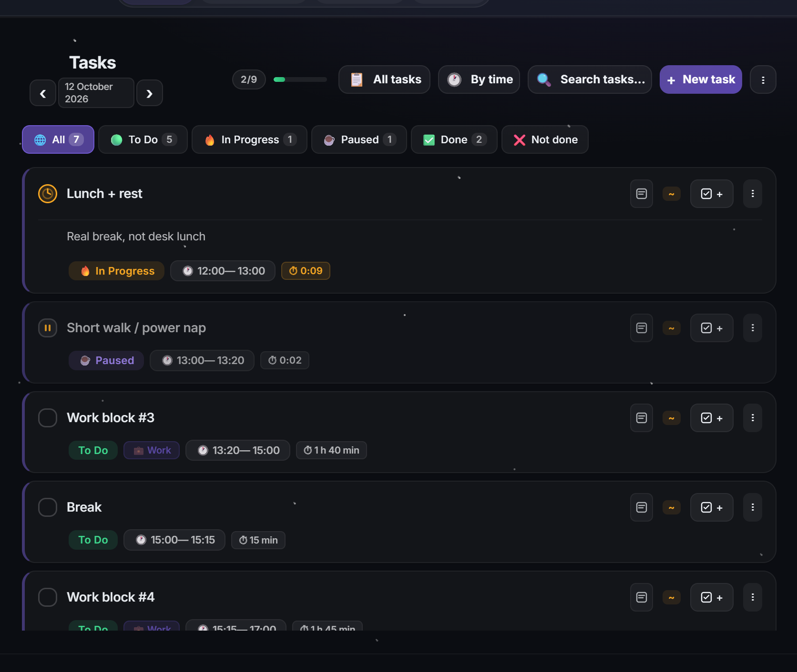

# WorkLife Calendar for Obsidian

> **Say goodbye to chaos.** A smart calendar, task tracker, time tracker, habit tracker, and finance manager—all in one beautiful, connected workspace.

<div align="center">

[](https://opensource.org/licenses/MIT)
[](https://obsidian.md)
[](https://svelte.dev/)
[](https://www.typescriptlang.org/)

</div>

---

[**Русский README**](https://github.com/AtinsS/WorkLife-Calendar-for-Obsidian/blob/master/README.RU.md)



## 💡 Why this plugin exists

Many workflows have the same problem: tasks live in one place, the calendar in another, time tracking in a third, while finances and reports are managed manually in spreadsheets. As a result, the same data has to be entered multiple times.

**This plugin solves that problem.** It doesn’t just add another calendar or task tracker. It connects planning, execution, and analysis in one system:

- A task affects your calendar.
- Your calendar feeds into time tracking.
- Tracked time is used to calculate income.
- Income powers automatic analytics.

---

## 🚀 Who it’s for

- **Freelancers and developers** who want to automatically calculate the value of their work by the hour.
- **Students and researchers** who need to keep track of deadlines, projects, and daily habits.
- **Anyone tired** of juggling a dozen disconnected apps and ready to get organized in one Obsidian workspace.

---

## ✨ What’s included

| Feature | What you get |
| :--- | :--- |
| **📅 Schedule** | Day / week / month calendar, drag and drop, weather in the calendar grid |
| **✅ Tasks** | Quick natural-language entry, Kanban, recurring tasks, live timer |
| **⏱ Time & income** | Work timer → hours × rate → automatic earnings |
| **⚖️ Habits & health** | Habit streaks, weight chart |
| **💰 Finances** | Budget planning, savings goals, income, expenses, Markdown / Excel summaries |
| **📊 Analytics** | Charts for projects, income, and habits |
| **🤖 Local AI (Ollama)** | Task extraction, summaries, schedule commands, AI chat with selection tools, expense analysis, workout plans, brainstorming in the context of a note |
| **🔔 Notifications** | Desktop reminders + phone push notifications via ntfy.sh |

> [!NOTE] 🎁 Bonus
> The `theme` folder includes a theme! Make Obsidian look even better.

---

## 📦 Installation

### Community plugins (recommended)

1. Open **Settings → Community plugins** in Obsidian.
2. Click **Browse** and search for **WorkLife Calendar**.
3. Click **Install**, then **Enable**.

### Via BRAT

1. Install the [BRAT](https://github.com/TfTHacker/obsidian42-brat) plugin.
2. Open **BRAT settings → Add Beta Plugin**.
3. Paste this link: `https://github.com/AtinsS/WorkLife-Calendar-for-Obsidian`
4. Click **Add Plugin**.

### Manual installation

1. Download the release archive or clone the repository.
2. Copy `main.js`, `manifest.json`, and `styles.css`.
3. Place them in `.obsidian/plugins/worklife-calendar/` (create the folder if it doesn’t exist).
4. Enable the plugin in *Settings → Community plugins*.

> [!WARNING] Requirements
> Obsidian **1.13.0+** is required. Works on desktop and mobile (AI is desktop-only).

---

## 🧭 Quick start

1. **Tasks** — open *Tasks* or click **“Quick Add Task”**, then type naturally: *“Submit report on Friday @Work !urgent”*.
2. **Finances** — open the *Finances* section. It has four tabs: **Budget / Savings / Income / Expenses**. Add your first expense in the **Expenses** tab.
3. **Monthly summary** — at the end of the month, select **Markdown** or **Excel** and click **“Summary”** to generate a report.

> [!TIP]
> Set your **Finances → Currency symbol** and **Summary folder** in the settings. It takes a minute and keeps your reports organized.

---

## ☕ Support

If the plugin saves you time and helps with your work, you can support its development:

- ⭐ Star the repository.
- [☕ Buy the author a coffee and a pastry](https://boosty.to/atins/donate).

---

<details>
<summary><h3>✨ Detailed features (expand)</h3></summary>

## 📅 Smart planning

- Understands natural language. Just type *“! tomorrow 14:00 submit project @Work”* and the plugin will automatically set the date, time, project, and priority.
- AI can help create multiple tasks from a single prompt.
- Visual day / week / month calendar with drag and drop. Drag a task to change its time.
- Weather in the calendar grid helps you plan your days.

## ✅ Focus and task management

- Kanban board and lists with five statuses: To Do → In Progress → On Hold → Done → Not Done.
- Live timer: track time right from a task card. The timer won’t reset if you restart Obsidian. (The timer starts when a task moves to **In Progress**; you can disable this in settings.)
- Recurring tasks: set them up once to repeat daily, weekly, or monthly.
- Automatically move overdue tasks to the next day (can be disabled).
- Work tasks with hourly or daily rates—the plugin calculates earnings automatically.

## ⚖️ Balance: habits and health

- Habit tracker with progress charts and streaks.
- Weight tracking: log your weight daily and view a chart showing progress toward your goal.

## 💰 Finances

A unified **Finances** section with four tabs—planned and actual figures are kept separate:

| Tab | What’s included |
| :--- | :--- |
| **Budget** | Monthly plan (estimates only): planned income, how to allocate it, how much to save, and rules. **Does not affect** actual figures |
| **Savings** | Savings goals; contributions are recorded as actual expenses |
| **Income** | Earnings from tasks (hours × rate or daily rate), additional income sources, and categories |
| **Expenses** | Actual spending, expense categories, text-based expense analysis (manual or AI-assisted), and savings contributions |

**Additional features:**

- **Automatic income calculation** — tracked time × your hourly or daily rate.
- **Monthly summaries** — select **Markdown / Excel** from the dropdown and click **“Summary”**:
  - **Markdown** — a note with totals, expenses by category, and savings contributions.
  - **Excel (.xls)** — seven sheets: summary, income, expenses, by category, by day, savings, and budget plan. With AI tips enabled, an additional **Tips** sheet is included.
- **Currency** — choose a symbol in settings: ₽, $, €, £, ₸, ₴, ₺, ¥, ₮, ₾, ₿, or enter your own text.
- **Analytics dashboard** — charts for projects, income, and habits.

## 🤖 Local AI (Ollama)

Runs entirely on your computer—your data isn’t sent anywhere.

> [!IMPORTANT] Requirements
> You need [Ollama](https://ollama.com) and at least one model. For example: `ollama pull llama3.1` or `ollama pull qwen2.5:7b`.

**What it can do:**

- **Tasks** — extract tasks from a note (right-click a `.md` file), break tasks into subtasks, generate descriptions, and use smart input (for example, “Create several tasks titled ‘Call’, repeat every Thursday, project ‘Work’”).
- **Notes** — summarize a folder or selected notes in these styles: Concise / Detailed / Bullet Points / For Managers / **Custom**.
- **Schedule (AI Actions)** — summarize a period, assess workload with **“Apply Recommendations”** (preview → confirmation), and process natural-language commands (“move tasks in the ‘Home’ project by one day,” “create ‘Buy milk’ next Thursday for 1 hour”). Changes always go through an **operation plan** that you confirm.
- **AI chat (Ask AI)** — brainstorm in the context of a note or group of notes (right-click → *AI Tools* or use the command palette). Select any text in chat for a floating **“Explain” / “Make task”** toolbar, or right-click the selection. Per-message actions: copy, send to note, make task, rewrite shorter/longer. Set your name, the assistant’s name, “About you”, and the communication style in *Settings → AI → Chat*.
- **Finances** — analyze expenses from text, forecast budgets, create allocation rules, and provide tips in Markdown / Excel summaries.
- **Workout plans** — questionnaire → plan → tasks and workout streaks. If you have no equipment, the plan uses bodyweight exercises only; static exercises (such as planks) always include a hold duration.

### Smart free time slots (on request)

A task **without a time stays untimed** by default. Ask for a free slot explicitly (e.g. *“Buy milk next Thursday, pick a free slot, 1 hour”*) and the plugin places it in the first available window (09:00–21:00, 30-minute grid), avoiding conflicts. The time is shown **before confirmation** in quick-add chips or AI review cards. If the day is fully booked, you’ll see a warning and the task is created without a time.

Available in **Quick Add** and **AI schedule commands**.

### Summary styles

| Style | Format | Best for |
| :--- | :--- | :--- |
| **Concise** | A heading plus 2–4 sentences covering everything in one continuous summary | Quickly refreshing your memory about a collection of notes |
| **Detailed** | Overview → Key ideas → Conclusions (bullet points) | Understanding the material in depth |
| **Bullet Points** | A bulleted list only, with no prose | Skimming or getting a quick introduction to a topic |
| **For Managers** | Main points → Facts and figures → Risks and questions | Meeting reports, status updates, and management briefings |
| **Custom** | Your own formatting rules (in settings or when generating a summary in the modal) | Corporate style, a fixed list of sections, language, or tone |

All styles create **one unified summary** of all notes, without separate sections for each file. Names, dates, and figures are preserved. The **Additional instructions** field is appended to the prompt—for example, “highlight only actions and dates.”

### AI actions in the schedule

| Tab | What it does |
| :--- | :--- |
| **Analysis** | Choose a period (day / week / month / etc.) and select *What’s done* or *Assess workload*. After the workload assessment, click **“Apply Recommendations”** to turn suggestions into operations, review the plan, and confirm. |
| **Command** | Enter a natural-language command → get an operation plan (`move`, `setStatus`, `setTime`, `create`, `delete`, etc.) → preview → click **Apply**. |

Every change is shown in advance. Recommendations from **What’s done** are not applied; that view is retrospective.

### One or two models

- **One model for everything** — the simplest option.
- **Two models by role** — one **primary model** for summaries, forecasts, tips, and workout plans, and one **parsing model** for expenses, quick entry, and subtasks. You can use a fast, lightweight model for parsing to get quicker responses.

### Privacy

- Requests go to the Ollama server you configure (by default, `http://localhost:11434`).
- The model receives **only the content needed for the current action**: note or summary text, task titles and times, amounts, chat questions and history. The chat also sends your name, “About you”, and communication style when filled in.
- Plugin settings (GitHub token, weather API keys) are **never** sent to the model — but if a note contains passwords, they go with the note text.
- ⚠️ The address field accepts remote endpoints (LAN / SSH / cloud). If you use **cloud-hosted Ollama models**, note / task / chat content is processed on the provider’s side and may be stored there — don’t send passwords or tokens. Keep it set to `localhost` for personal data.
- AI is hidden on mobile and works only on desktop.

**Settings:** *Settings → AI (Ollama)* — enable AI, configure the address and models, toggle actions, and manage privacy settings.

## 🔔 Notifications that help you stay on top of things

- Desktop reminders N minutes before an event.
- Phone notifications via ntfy.sh, so you can receive deadline reminders even when Obsidian is closed.

</details>

<details>
<summary><h3>🔗 Sync and integrations (expand)</h3></summary>

### Data storage format

The plugin stores data as JSON files in the `calendar-data/` folder at the root of your vault. When **“Sync to vault root”** is enabled, this becomes the primary data storage format and supports fast loading and syncing via:

- **Obsidian Sync** / **Remotely Save***
- **Syncthing**

> [!WARNING] Financial data
> If you track finances in the plugin and use cloud sync, your income and expense data will be stored unencrypted in the cloud. Consider using generic project names or excluding the `calendar-data/` folder from sync.

### External calendars (Google Calendar and others)

1. Create a [GitHub Personal Access Token](https://github.com/settings/tokens) (classic) with the `gist` scope.
2. Paste the token into the plugin settings and click **“Sync”**.
3. The plugin will create a Gist containing an `.ics` file and provide a link.
4. Add that link to your calendar using its **Subscribe by URL** feature.

Optionally, enable **auto-sync** to update the Gist whenever tasks change.

</details>

<details>
<summary><h3>🔔 Notifications (expand)</h3></summary>

The plugin includes a notification system to help you stay on top of important things.

| Type | When it triggers |
| :--- | :--- |
| **Local (browser)** | N minutes before an event, when a task is overdue, when a time limit is exceeded, or on a deadline day |
| **On your phone (ntfy.sh)** | Push notifications delivered to your phone |

### Setting up ntfy.sh

A simple way to receive notifications on your phone:

1. Install the [ntfy.sh](https://ntfy.sh/) app on your phone.
2. Enable **ntfy.sh** in the plugin settings and set a topic.
3. Subscribe to that topic in the app.

You can also enable **scheduled push notifications** (queued when Obsidian opens so they arrive on time, even when it’s closed) and a **daily digest**. The digest includes the day’s tasks, weather, and habits, and can be sent either as a delayed push (arrives even if Obsidian is closed) or only while Obsidian is open.

> [!CAUTION] Security
> Use a unique topic, such as a randomly generated UUID like `a7f9b2c4-8e1d-4f3a-9c5b-2d6e8f0a1b3c`, so no one else can subscribe to your notifications. The plugin sends only notification triggers (for example, “Overdue: Task title”), not financial data or full text.

</details>

<details>
<summary><h3>🧭 Widgets in notes (expand)</h3></summary>

### Dashboard

Insert this code block into any note to add a widget panel (tasks / habits / goals):

````markdown
```dashboard
```
````

Or right-click the page and select **“Insert Dashboard”**.

Dashboard widgets (tasks / habits / goals) can be configured in *Settings → Dashboard*.

### Greeting

Insert a greeting with quick navigation, note search, and weight entry:

````markdown
```hello
```
````

Or right-click the page and select **“Insert Greeting”**.

Quick weight entry and note search can be shown in the greeting and toggled under *Settings → Dashboard → Greeting Buttons*. You can also customize the order of navigation buttons.

</details>

---

## 🐛 Issues and bug reports

Found a bug or have a feature request? Open an issue on GitHub:

**[Open an Issue](https://github.com/AtinsS/WorkLife-Calendar-for-Obsidian/issues)**

When reporting a bug, please include:

- Obsidian version
- Plugin version
- Steps to reproduce
- Expected and actual behavior
- Console errors, if any: *Ctrl+Shift+I → Console tab*

---

## Credits and license

This project is based on [obsidian-calendar-plugin](https://github.com/liamcain/obsidian-calendar-plugin) by [Liam Cain](https://github.com/liamcain) (MIT) and has been significantly expanded.

Third-party libraries bundled in `main.js` are listed in [THIRD_PARTY_NOTICES.md](THIRD_PARTY_NOTICES.md).

<div align="center">
  <sub>Made with attention to detail for the Obsidian community</sub><br>
  <sub>Author: <a href="https://github.com/AtinsS">@AtinsS</a></sub><br>
  <sub>License: <a href="https://opensource.org/licenses/MIT">MIT</a></sub>
</div>